Bitmoji Ski started with a memory. On my first day skiing, two of my friends dropped me in front of a slope that looked terrifying, and I've never forgotten that mix of fear and excitement. What I wanted to bottle is what comes next: the cold air, the hush of the snow and the thrilling, chilled-out feeling of sliding down a mountain with nothing to do but steer.

The catch is that I'm an engineer, and for years I've wanted to build a really fun game. For years my games were boring. My brain goes straight to architecture, performance and getting the physics right, and by the time everything works I have no energy left for the only question players care about: is this fun?

So when I needed a test game for the new Snapchat Web Lens features, I flipped the order. I let an LLM write the boring base in minutes, then spent my time playing the game and fixing whatever felt off, one small change at a time. The result is **Bitmoji Ski**: you, as your own Bitmoji, snowboarding down an endless mountain. It took about **seven hours**, it's **1.3 MB** zipped and it has had **300 million views** on Snapchat.

This post tells the story screenshot by screenshot, and shows how you can use the same method with PlayCanvas and Snapchat Web Lenses:

* 👉 **Play it.** Scan the Snapcode below with your phone's camera or with Snapchat, and it opens straight in Snapchat. Or just search for Bitmoji Ski.
* 👉 **Build your own.** The [Web Lenses documentation](https://developers.snap.com/web-lenses/home) has everything you need, and [Snapchat Now Supports PlayCanvas Games](/snapchat-now-supports-playcanvas-games) walks through the full setup.

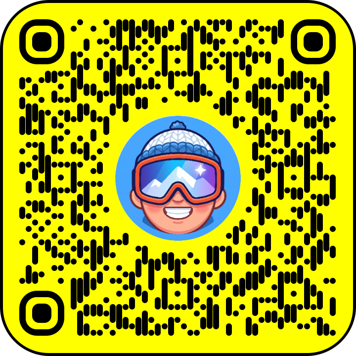

<p style={{textAlign: 'center'}}><em>Scan with your phone's camera or Snapchat to play</em></p>

<video playsInline autoPlay muted loop controls src='/img/snapchat-web-lenses-bitmoji-ski.mp4' style={{width: '50%', height: 'auto', display: 'block', margin: '0 auto 1.5em'}} />

That's a screen recording of the Lens running inside Snapchat. The sound is on in the game, from the wind to the little "oof" when you hit a tree, and all of it is generated in code. There isn't a single audio file in the Lens.

<!-- truncate -->

## 🧠 The Idea: Core Loop First, Hooks Second

An LLM is superb at the boring 80%: project setup, a slope, input, scoring, game over, packaging. It can't tell you whether the game is fun. That part is yours. So I worked in two phases:

1. **Base.** Get one complete, playable loop on screen as fast as possible. Ugly is fine.
2. **Hooks.** Play it, find the weakest moment, ask for one small change, play again. Repeat.

A hook is anything that makes a player feel something or come back: a sound, a camera move, a rival, a streak message, a leaderboard. Because the base is small and stays small, every hook is one message away, and any hook that doesn't work gets thrown out.

This is the order I added mine:

| # | Hook | Why it earns its place |
| --- | --- | --- |
| 1 | Core loop: steer, jump, spin, flags, score | Something to master |
| 2 | Art: sky, mountains, fog, trees | It looks like somewhere you want to be |
| 3 | You: your own Bitmoji, plus rival Bitmojis | It's about me |
| 4 | Drama: ragdoll wipeouts, snow bursts | Failing is fun to watch |
| 5 | Feedback: streaks, announcements, sound | Every move gets a reaction |
| 6 | Goals: leaderboard, board unlocks | One more run |
| 7 | Polish: instant loading, no stutter | Nobody leaves before it starts |

## 🏗️ Step 1: Let the LLM Build the Boring Base

A PlayCanvas Engine game is a regular JavaScript project, so an agent such as Claude Code can read it, run it and fix it while you describe what you want. Today the quickest start is the Web Lens starter from `create-playcanvas`, which already has the Web Lens API wired up:

```bash
npm create playcanvas@latest my-lens -- --starter web-lens
```

Install the [PlayCanvas Skills](https://github.com/playcanvas/skills) too, so your agent knows how to build polished PlayCanvas apps:

```bash
npx skills add playcanvas/skills
```

My first prompt was roughly this:

```text
Build a downhill snowboarding game in PlayCanvas where my Bitmoji slides down
the mountain. It needs a score, a leaderboard and a clear end of run, so I can
test the leaderboards, Bitmoji and storage capabilities. Keep it small and fast.
No buttons on screen.
```

About fifteen minutes later I had a playable game. It worked on the first run. It was also flat, lavender and joyless: system font, instructions pasted on the title screen and mountains that looked like a pile of spikes.

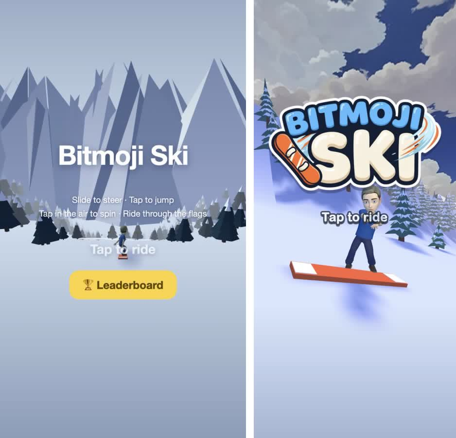

*Left: the first playable. Right: the menu today.*

## 🕹️ Step 2: Make the Loop Fun Before You Make It Pretty

I resisted the urge to decorate and played the boring version until the loop felt right:

* **No buttons on screen.** Hold and slide to steer, tap to jump, tap in the air to spin. Players discover the controls by playing, so I deleted the instructions from the start screen. It's just the title and "Tap to ride".
* **Flags to thread.** Ride through them in a row and the combo builds (+20 × combo). I made the flags bright red because the slope is white and you must always see where to go.
* **Slow, earned scores.** My first scores were ridiculous: two seconds of riding gave 1,500 points. I cut the growth by 5×, because a number only means something if it's hard to get.
* **Short runs.** A run lasts 30 to 60 seconds, a wipeout ends it instantly and restarting is one tap.

:::tip[Try it now]
Don't add a single hook until you'd play the bare loop twice without being asked to. If the loop is boring, no amount of fog will save it.
:::

## 🎨 Step 3: Art Direction Is the Upgrade

This is where the game stopped looking like a tech demo. Five frames, left to right: the first playable, a stylized sky, painterly mountains, fog and the game today.

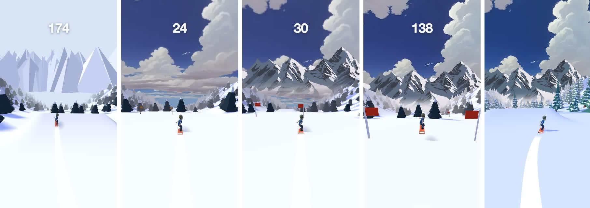

**The sky.** A stylized skybox from [freestylized.com](https://freestylized.com/skybox/sky_14/) (royalty-free), cropped to the band the camera actually sees and mapped onto a dome that follows the camera. I dropped it so the cloud layer sits right on the horizon. That one move is why it feels like you're riding into the clouds.

**The mountains.** I wanted a painterly range, not code-drawn spikes, so I picked a look I liked and asked Gemini for a wider range in the same style on a flat magenta background. A small script then keys the magenta out into alpha. The prompt that matters:

```text
Everything that is not mountain must be ONE flat solid pure magenta, #FF00FF.
No sky, clouds, haze or text. The LEFT and RIGHT edges must join seamlessly
when tiled side by side. The bottom 20% is flat solid snow #ECE9EE.
```

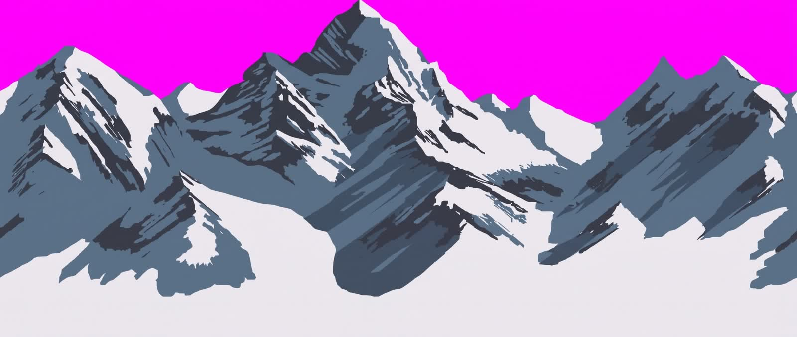

I made the choices and Gemini drew the pixels. That split worked well.

### 🌫️ The Fog That Stops Mountains Looking Like a Billboard

Painterly mountains behind a 3D slope have one big problem: they look like a poster. There's a hard seam where the snow meets the picture, and when you jump you can see the bottom of the painting, which in my case included a strip of lake.

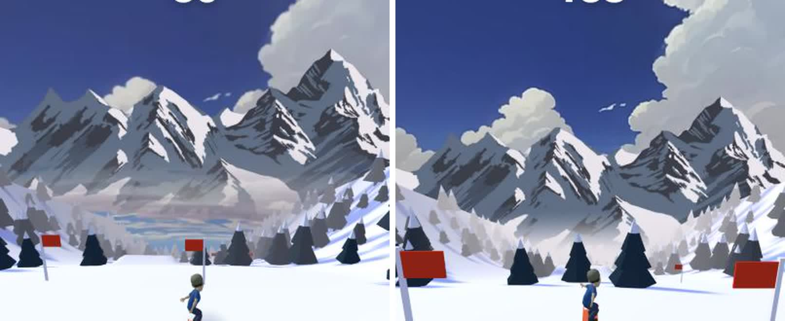

*Left: the billboard problem, with a strip of painted lake under the peaks. Right: the same view with the fog fix.*

The fix is to make everything far away the same color:

1. The **fog color** is the color at the base of the mountain painting.
2. The bottom third of the painting is **blended into that color** in the source image.
3. A fog-colored **skirt** sits below the horizon, so a big jump never reveals the sky's lower rows.
4. **Linear fog** from 35 to 140 meters fades the trees and the slope into that same color.

Slope, haze and mountains become one gradient, and your eye reads depth instead of a picture.

```js
import { Color, FOG_LINEAR } from 'playcanvas';

// One color for everything far away: the base of the mountain painting,
// the fog and the clear color all match.
const HAZE = new Color(0xe7 / 255, 0xe1 / 255, 0xe8 / 255);
app.scene.fog.type = FOG_LINEAR;
app.scene.fog.color = HAZE;
app.scene.fog.start = 35;
app.scene.fog.end = 140;
camera.camera.clearColor = HAZE;
```

:::tip[Try it now]
Pick your fog color from your backdrop art, not from your gut, and bake the same color into the bottom of the image. Ten minutes of work, and it's the biggest quality jump in the whole project.
:::

## 🌲 Step 4: Trees From Blender, Built by Claude

To be honest about this one: I didn't model the trees. I connected Claude to Blender using the Blender MCP add-on, attached a picture of the kind of low-poly tree I wanted and asked for three or four different models with a low poly count. Claude scripted them inside my open Blender. Then I asked for snow on top, and it took a few rounds before the snow caps sat where you could actually see them.

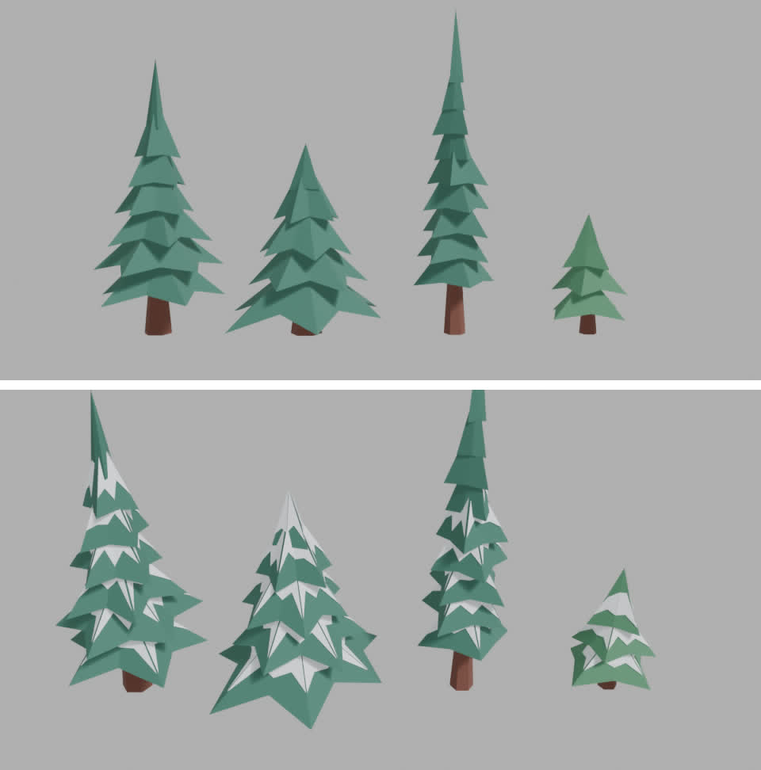

I took the GLB, and a small script baked the four trees into a compact binary (int16 positions, 25 KB in total) that's embedded in `game.js`, so nothing is parsed at startup. Every tree on a 50 m chunk is merged into the chunk's single vertex-colored mesh, which means **one draw call per chunk**.

The shadows are baked too: the color of snow in shadow is the color of snow lit by the cool blue ambient light alone, so tree shadows come out blue, like a real sunny morning in the mountains. Only the riders cast real-time shadows.

## 🧑‍🎤 Step 5: Make It About the Player

The [Bitmoji capability](https://developers.snap.com/web-lenses/bitmoji) gives you the player's own Bitmoji as a rigged 3D model:

```js
await snapchat.init();

if (snapchat.isSupported('bitmoji') && !snapchat.isStub) {
    const { hasAvatar } = await snapchat.bitmoji.getAvatarInfo();
    if (hasAvatar) {
        // The URL expires in a few minutes, so hand it straight to the GLB loader
        const { url } = await snapchat.bitmoji.get3DAvatar();
    }
}
```

:::note
How to handle players who don't have a Bitmoji is being updated. Check the [Bitmoji docs](https://developers.snap.com/web-lenses/bitmoji) for the current guidance before you ship.
:::

Players recognize themselves immediately, and that changes how everything feels. A wipeout is funnier when it's you, and a high score matters more. So I leaned in:

* **Rivals are you.** The other skiers are clones of your Bitmoji with recolored outfits. You're racing an army of yourself, and about one in five of them wipes out ahead of you.
* **A dancing start screen.** Your Bitmoji dances on the start screen, using two Mixamo clips retargeted onto the Bitmoji rig and packed into 20 KB. It's the first thing players see, so the character has to be alive.

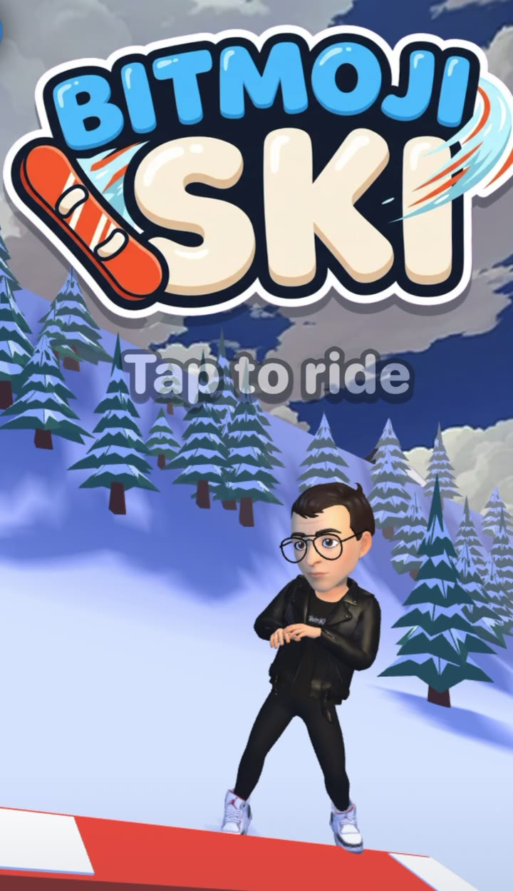

<p style={{textAlign: 'center'}}><em>Bitmoji Ski puts the player's own Bitmoji on the slopes</em></p>

## 💥 Step 6: Make Failing the Best Part

You will crash a lot, so crashing has to be fun to watch.

* **Ragdolls.** A hit turns your Bitmoji into a Verlet ragdoll with about 18 joint particles and limits on knees, elbows and hips, and the board tumbles away on its own. I wrote this instead of using a physics engine, which saves a megabyte of WebAssembly.
* **Snow everywhere.** Landings and body hits throw bursts of snow, pooled into one dynamic mesh.
* **Camera drama.** The camera eases toward the falling body so you can see it, and the results screen waits a second so you get to watch yourself land.
* **Stomps.** Land on a rival from above and they go over while you ride on.

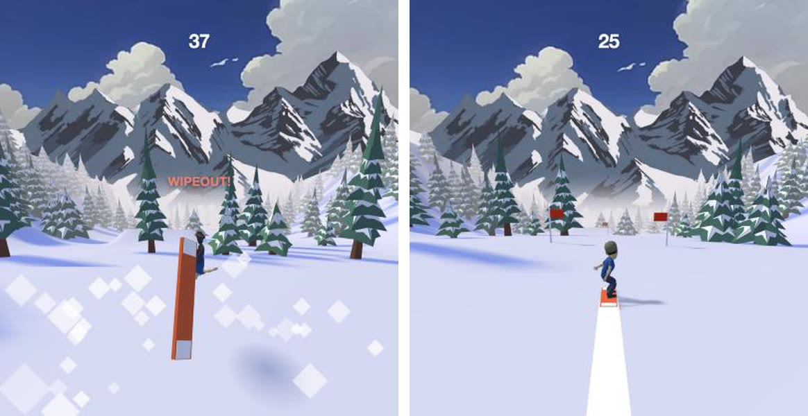

**Sound** is built the same way, from filtered noise and oscillators with the Web Audio API. Wind starts almost silent, builds with your speed and cuts out completely when you're airborne, which makes every jump feel higher. Landings thud, and the first hit gets a soft "oof".

**Feedback** comes from words. A message line under the score pops in and wobbles for every event: STREAK +2, ON FIRE!, CLOSE CALL!, BIG AIR!, STOMP!. The type is a heavy rounded face with a thick dark outline, built from system fonts, so there are zero font files.

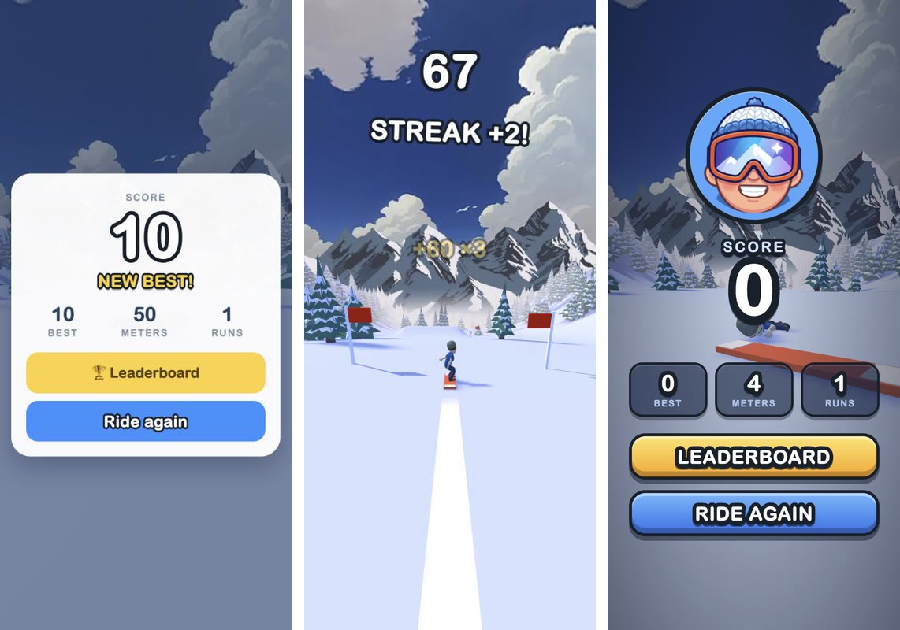

## 🏆 Step 7: Give People Something to Beat

A game is a toy until there's a number to beat. The [leaderboards capability](https://developers.snap.com/web-lenses/leaderboards) turns a solo run into a competition, and it costs almost nothing to support. Submit the score when the run ends, then show Snapchat's own panel:

```js
async function onGameOver(score) {
    if (!snapchat.isSupported('leaderboards')) return;

    try {
        await snapchat.leaderboards.submitScore({ score: Math.round(score) });
        await snapchat.leaderboards.show();
    } catch (err) {
        // Never let a leaderboard failure end the fun
        console.warn('Leaderboard unavailable:', err.message);
    }
}
```

The competition continues when the Lens is closed: when a friend beats your score, Snapchat can invite you back to reclaim your spot.

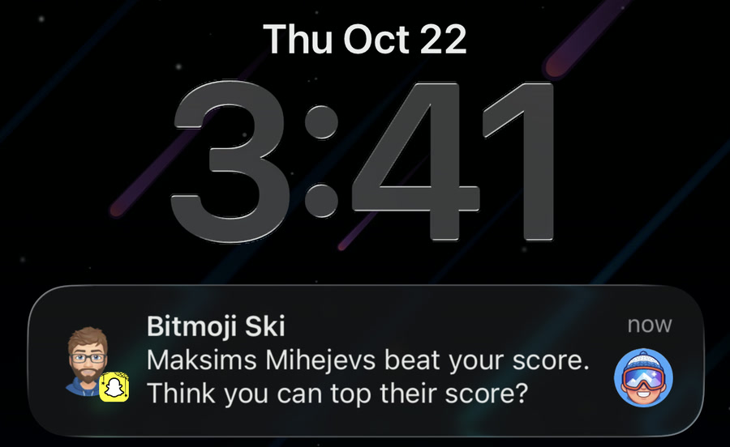

<p style={{textAlign: 'center'}}><em>A leaderboard notification from Bitmoji Ski</em></p>

Goals that don't depend on friends matter too. At 1,000, 3,000 and 5,000 points you unlock a new board design (Sunny Pop, Blaze and a metallic Golden Legend), and the board you've earned is waiting under your dancing Bitmoji next time. That's the [storage capability](https://developers.snap.com/web-lenses/storage), because in a Lens `localStorage` starts empty every launch:

```js
const saved = await snapchat.storage.get('ski');
const save = saved.found ? saved.value : { best: 0, runs: 0, boards: 0 };

// when a score mark is passed:
save.boards = Math.max(save.boards, tier);
await snapchat.storage.set('ski', save);
```

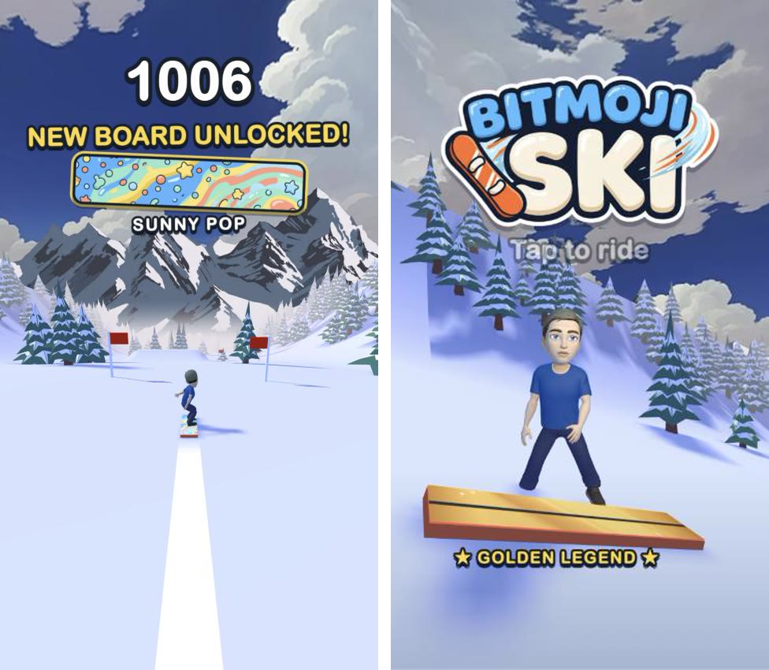

## 📦 Step 8: Keep It Tiny, Make It Instant

Bitmoji Ski is about **1.3 MB zipped**, and I treated that number as a feature. Snap's own docs say that [time to first play is "the strongest lever you have on how a Lens performs with its audience"](https://developers.snap.com/web-lenses/requirements#size-limit). Plenty of Snapchat's audience plays on older iPhones and mid-range Androids, and not always on a fast connection. For them, a game that appears at once and runs smoothly is a game they actually play. A game that makes them wait gets swiped away before the first tap.

And this is where PlayCanvas earns its place. The engine is tiny. Import only the classes you use and the bundler drops the rest, so the engine you ship is only the part your game touches. In Bitmoji Ski, that engine, all of the game code and the baked trees come to about **315 KB zipped**, which is smaller than the Bitmoji character model alone. A heavier engine would eat a big share of the budget before the first tree appeared.

Here's roughly where the bytes go (zipped):

| What | Size |
| --- | --- |
| The entire PlayCanvas engine, tree-shaken, plus all game code | ~315 KB |
| Character model and rig | ~490 KB |
| Sky image | ~140 KB |
| Start and results screens, with the inlined loading still | ~130 KB |
| Mountains | ~40 KB |
| Three board designs | ~60 KB |
| Dance clips | ~20 KB |
| Audio files and font files | 0 |

The rest of the performance work is mostly about doing less:

* **Engine only, tree-shaken.** Import PlayCanvas classes by name and your bundler drops the rest.
* **One draw call per 50 m of slope.** The ground, flags and trees are one vertex-colored mesh per chunk, with no textures. The whole game draws in roughly 30 draw calls and holds 60 fps.
* **A loading screen that is the first frame.** I capture the first frame of the start screen, inline it into `index.html` as a data URI and cross-fade out of it once the real scene has rendered. Players never see a spinner.

```js
// build step: the first-frame still paints with the very first frame, no request
html = html.replace('__SPLASH__',
    'data:image/webp;base64,' + (await fs.readFile('assets/splash.webp')).toString('base64'));
```

* **Compile shaders before the player taps.** WebGL compiles a shader the first time something is drawn, so rivals, ragdolls and shadows all caused a hitch the first time they appeared. Now the game rides itself for a few simulated seconds under the loading still, so nothing compiles mid-run.

```js
for (let i = 0; i < 120; i++) {
    step(1 / 30);
    if (i % 4 === 0) app.render();
}
```

:::tip[Try it now]
Count compiled shader programs (`device.shaders.length` in PlayCanvas) before and after a full play-through. If the number goes up during play, a player on a slow phone will feel a stutter. And test on the oldest phone you can find.
:::

## ⏱️ Where the Seven Hours Went

Roughly, from my timestamps:

| Time | What |
| --- | --- |
| ~15 min | First playable: slide, jump, flags, trees, score, game over |
| ~1 h | Sky, mountains and fog |
| ~1.5 h | Trees in Blender, rival Bitmojis, ragdolls, snow bursts |
| ~30 min | Synthesized sound |
| ~1 h | Icon, preview video, loading still, zip |
| ~3 h | Day two: dancing start screen, typography, results screen, board unlocks |

Most of those hours went on taste, not code.

## 🎮 What You Need to Build Your Own

* 🏔️ **Platform.** [Snapchat Web Lenses](https://developers.snap.com/web-lenses/home): a zip of a web app, published through [My Lenses](https://my-lenses.snapchat.com/).
* ⚙️ **Engine.** The [PlayCanvas Engine](https://github.com/playcanvas/engine), engine-only and tree-shaken.
* 🤖 **Base.** An LLM, the `web-lens` starter and the [PlayCanvas Skills](https://github.com/playcanvas/skills). Or the [PlayCanvas Editor with its MCP server](https://developer.playcanvas.com/user-manual/editor/mcp-server/) if you prefer a visual editor.
* 🎨 **Art.** A stylized sky, a mountain range, Gemini for the stylized bits and Blender (with the Blender MCP add-on) for low-poly models.
* 🧩 **Snapchat features.** The [Web Lens API](https://developers.snap.com/web-lenses/web-lens-api) for [Bitmoji](https://developers.snap.com/web-lenses/bitmoji), [leaderboards](https://developers.snap.com/web-lenses/leaderboards) and [storage](https://developers.snap.com/web-lenses/storage).
* 📏 **Discipline.** Read the [platform requirements](https://developers.snap.com/web-lenses/requirements) and the [runtime environment](https://developers.snap.com/web-lenses/runtime-environment), and test on a slow phone.

## 👂 Try It, Then Build Yours

Play Bitmoji Ski, then break it: thread a long streak of flags, hit a tree on purpose and see how you rank. Then build your own Web Lens. Get the base running first, make the loop fun and add hooks one at a time.

If you get stuck or want to show what you made, find me and the other Web Lens developers in the **#snapchat-web-lenses** channel on the [PlayCanvas Discord](https://discord.gg/RSaMRzg).

See you on the slopes. ❄️

---

*A note on AI: I see it as a way to unblock people who have great ideas but not the technical skills to build them.*
