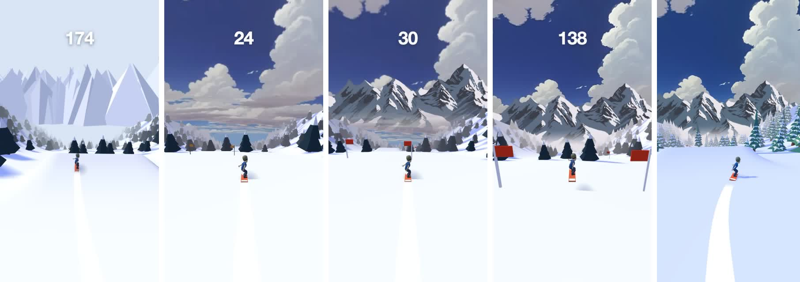
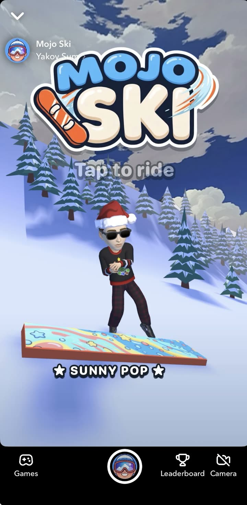
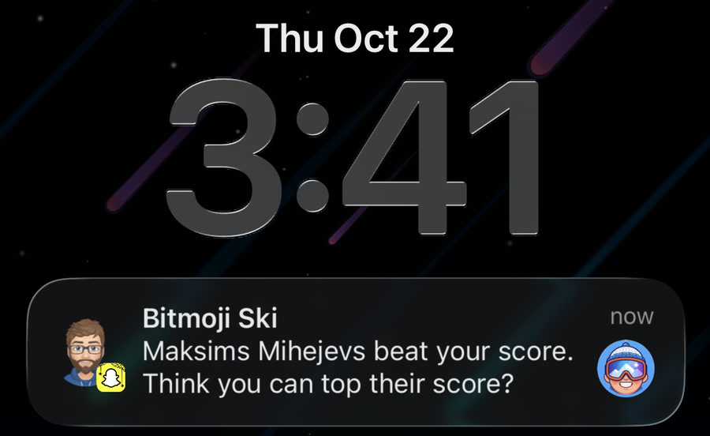

import GameSpotlight from '@site/src/components/GameSpotlight';

<GameSpotlight
  reverse
  title="Mojo Ski"
  video="/img/snapchat-web-lenses-bitmoji-ski.mp4"
  snapcode="/img/snapchat-web-lenses-bitmoji-ski-snapcode.svg"
>

Snap recently launched **Web Lenses**, a brand-new way to put web games inside Snapchat, where they open with a tap just like any other Lens. 🎉

I built one of the first: **Mojo Ski**, a snowboarding game where you race down the mountain as your own Bitmoji. It has now been viewed **300 million times** on Snapchat.

</GameSpotlight>

There was no app store and nothing to install: I uploaded a zip of a web game, and Snapchat put it in front of its players. In this post, I'll show why Snapchat is such a good place to launch a game, how I made Mojo Ski and how you can build your own.

<!-- truncate -->

:::info[Mojo Ski at a glance]

- **Views:** 300 million on Snapchat
- **Gameplay:** Endless downhill snowboarding, starring the player's own Bitmoji
- **Engine:** [PlayCanvas](https://github.com/playcanvas/engine)
- **Size:** 1.3 MB zipped
- **Snapchat features:** Bitmoji, leaderboards and storage

:::

## Why Launch Your Game on Snapchat? 🚀

Snapchat is used by [971 million people every month](https://www.businesswire.com/news/home/20260803600317/en/Snap-Inc.-Announces-Second-Quarter-2026-Financial-Results), and Snap reports that [Game Lenses engage over 175 million people every month](https://ar.snap.com/blog/monetizing-with-snap). Web Lenses open that audience up to web game developers for the first time.

Compare that with the usual route. On an app store, a player has to find your game, install it and open it, and every one of those steps is a chance to lose them. On Snapchat, your game lives inside an app they already have open:

- **No install.** A Lens opens with a tap. Players can find yours by name, or scan its Snapcode with their phone's camera.
- **No store listing to fight for.** Zip up your web build, upload it through [My Lenses](https://my-lenses.snapchat.com/) and Snapchat publishes it like any other Lens.
- **Free cold start.** You don't need an ad budget to find your first players. Snapchat's content ranking looks for the Lenses people enjoy and shows them to more Snapchatters, so a fun game can find its audience.
- **Friends bring friends back.** Leaderboards are built in, and when a friend beats your score, Snapchat invites you back to reclaim your spot.
- **You can earn from it.** With [Lens+ Payouts](https://developers.snap.com/lens-studio/monetization/lens-creator-rewards/lens-plus-payouts), you can make your Lens exclusive to Lens+ and Platinum subscribers and earn a share of revenue based on how much it's played.

## How I Made Mojo Ski 🏂

Mojo Ski is simple to play: hold and slide to steer, tap to jump, tap again in the air to spin and thread the red flags for combos. One crash and the run is over. Nearly all of the work went into making that loop feel great, and here's what made the biggest difference.

### 1. Get a Playable Base, Fast ⚡

I described the game to an LLM and had a playable version about 15 minutes later. It worked, and it was boring: flat colors, spiky mountains and no reason to play twice. That's fine! The base only has to work. The fun comes next.

The quickest way to start is the Web Lens starter, which comes with the Web Lens API already wired up:

```bash
npm create playcanvas@latest my-lens -- --starter web-lens
```

### 2. Make It Fun Before You Make It Pretty 🕹️

I kept playing the ugly version until the loop felt right:

- **No buttons on screen.** Players discover the controls by playing, so the start screen just says "Tap to ride".
- **Bright red flags.** On a white slope, you always need to see where to go next.
- **Short runs and hard-earned scores.** A run lasts 30 to 60 seconds and restarting is one tap. I also cut the scoring by 5×, because a number only means something if it's hard to get.

:::tip
Don't add any art until you'd happily play the ugly version twice in a row. If the loop is boring, no amount of polish will save it!
:::

### 3. Then Make It Beautiful 🎨

This is where Mojo Ski stopped looking like a tech demo. A stylized sky, a painterly mountain range drawn with Gemini and low-poly trees built in Blender did most of the work.

  
*From left to right: the first playable, a stylized sky, painterly mountains, fog and the game today*

The biggest single upgrade was the fog. Its color is picked from the bottom of the mountain painting, so the slope, the haze and the peaks blend into one scene instead of looking like a poster stuck behind the slope.

### 4. Make It About the Player 🤩

The [Bitmoji capability](https://developers.snap.com/web-lenses/bitmoji) puts the player on the slopes as their very own Bitmoji, and every rival on the mountain is a clone of them in a different outfit. Players recognize themselves instantly. A wipeout is funnier when it's you, and a high score means more.



<p style={{textAlign: 'center'}}><em>Your Bitmoji dances on the start screen, next to the best board you've unlocked</em></p>

### 5. Make Crashing the Best Part 💥

You crash a lot in Mojo Ski, so crashing has to be fun to watch. Your Bitmoji tumbles as a ragdoll, snow bursts everywhere and the camera lingers so you can watch yourself land. Streak messages and sound react to every move, and all of the sound is generated in code, so there isn't a single audio file in the game.

### 6. Give Players a Reason to Come Back 🏆

A game is a toy until there's a number to beat. The [leaderboards capability](https://developers.snap.com/web-lenses/leaderboards) turns every run into a competition with your friends, and it only takes a few lines:

```js
async function onGameOver(score) {
    if (!snapchat.isSupported('leaderboards')) return;

    try {
        await snapchat.leaderboards.submitScore({ score: Math.round(score) });
        await snapchat.leaderboards.show();
    } catch (err) {
        // Never let a leaderboard failure end the fun
        console.warn('Leaderboard unavailable:', err.message);
    }
}
```

The competition carries on after the Lens is closed. When a friend beats your score, Snapchat lets you know:



<p style={{textAlign: 'center'}}><em>A friend beat your score. Time for one more run!</em></p>

Solo players get goals too: new boards unlock at 1,000, 3,000 and 5,000 points, saved between sessions with the [storage capability](https://developers.snap.com/web-lenses/storage).

### 7. Keep It Tiny 📦

Snap's own docs call time to first play ["the strongest lever you have on how a Lens performs with its audience"](https://developers.snap.com/web-lenses/requirements#size-limit). Mojo Ski is just 1.3 MB zipped, so it starts almost instantly, even on older phones and slow connections.

PlayCanvas makes this easy. Import only the engine classes you use and your bundler drops the rest. In Mojo Ski, the engine and all of the game code together come to about 315 KB zipped, which is smaller than the Bitmoji model alone.

## Build Your Own Web Lens 🛠️

Ready to make your own? Here's how to get started:

- **Write the code.** Run the starter command above, then follow [Snapchat Now Supports PlayCanvas Games](/snapchat-now-supports-playcanvas-games) for the full walkthrough, from the Web Lens API to publishing. The [Web Lenses documentation](https://developers.snap.com/web-lenses/home) has everything else.
- **Or skip the code.** [Easy Lens](https://easylens.snapchat.com/web-lenses) is Snap's AI Lens creator, and it builds PlayCanvas-powered Web Lens games from a prompt in a few minutes.
- **Get funded.** Snap is inviting developers to [pitch original Web Lens games](https://docs.google.com/forms/d/e/1FAIpQLScKS4gO8KW7nd4m1JzYayIjoktkzJbqDjWugrdvmpDz92Joow/viewform) and request a budget to build them.

## Join the Community 💬

We can't wait to see what you build! Join the **#snapchat-web-lenses** channel on the [PlayCanvas Discord](https://discord.gg/RSaMRzg) to ask questions and share your progress. And when you post your Web Lens on social media, tag PlayCanvas on [X](https://x.com/playcanvas) and [LinkedIn](https://www.linkedin.com/company/playcanvas) so we can help spread the word.

See you on the slopes! ❄️
